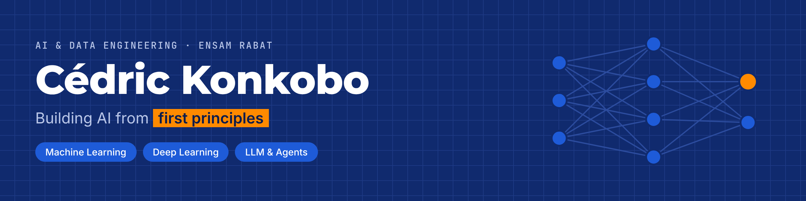

I'm an AI & Data Engineering student at **ENSAM Rabat**. I learn models from first principles — building them from scratch before using libraries — and take them all the way to deployed, explainable applications.

Open to **AI / Data internships** and **research opportunities**.

## Currently

- Reading `CRAG` and `Self-RAG` to build a production-oriented **RAG** system
- Building a **voice-to-location AI for Mooré**: spoken place names in Ouagadougou → GPS coordinates *(industry project, building the city's place-name dataset)*
- Building an AI system against **institution impersonation scams** — *finalist at the Benin AI Hackathon*

## Achievements

- **1st place** — Actionner 2.0, ENSAM entrepreneurship competition
- **3rd place** — Enactus ENCG entrepreneurship competition
- **Top 28%** — Zindi machine learning competition (172 / 609)

## Tech stack

**ML / DL** 

**LLM & Agents** 

**Deployment** 

## Contact

